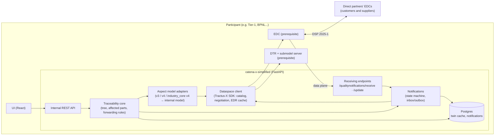
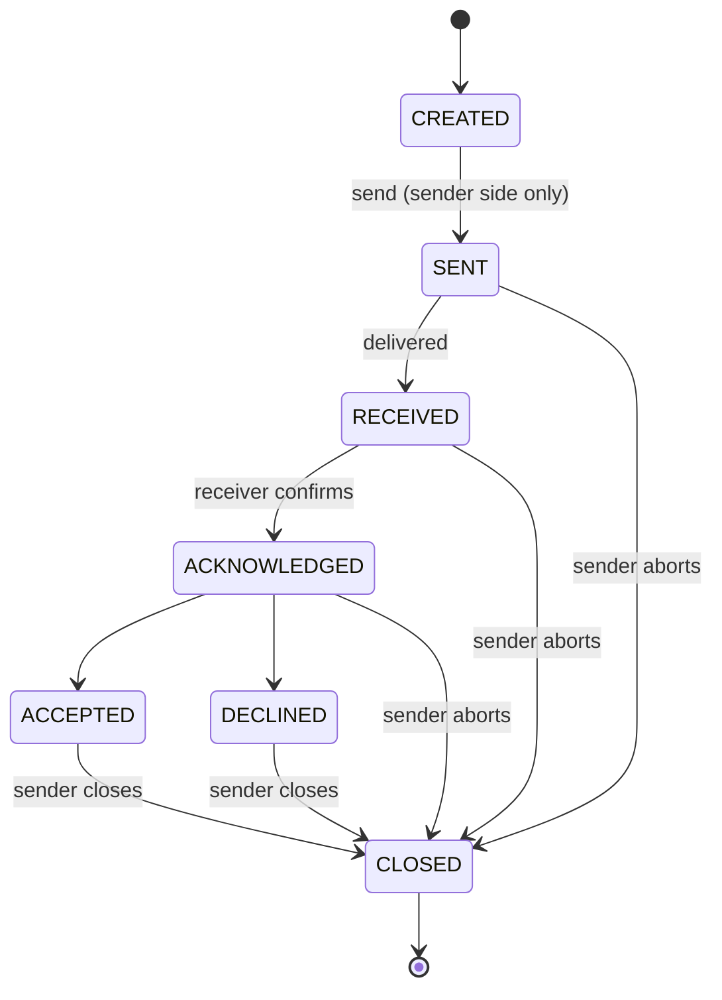
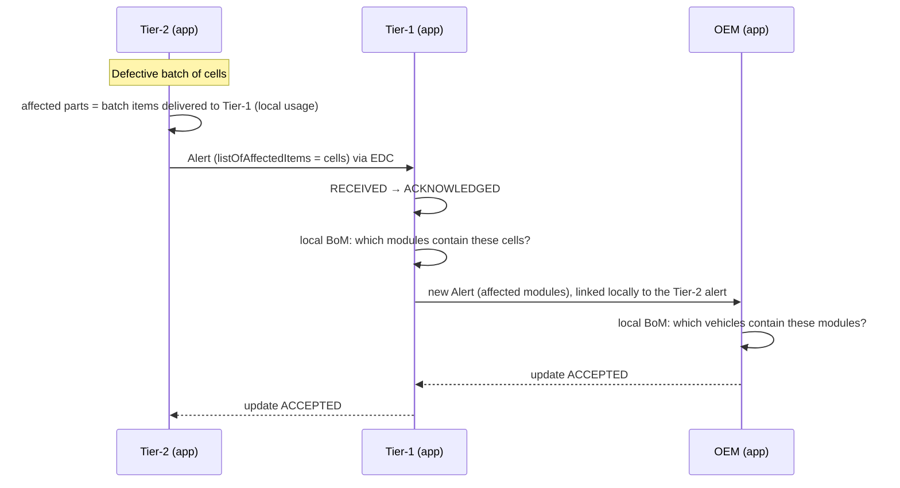

# Architecture — catena-x-simplified

> Status: phase 1 implemented (v0.1) · Baseline: **Eclipse Tractus-X 26.03** · KIT: **Traceability KIT 8.0.0**
>
> Terms: see the [glossary](glossary.md).

## 1. Goal

A **lightweight, interoperable** traceability application for Catena-X that meets the mandatory
requirements of the [Traceability KIT](https://github.com/eclipse-tractusx/eclipse-tractusx.github.io/tree/main/docs-kits/kits/traceability-kit)
without inheriting the complexity of Trace-X (`eclipse-tractusx/traceability-foss`), which has not been
maintained since release 25.06.

### 1.1 Scope (KIT functional requirements)

| KIT requirement                            | Mandatory | In this app             |
|--------------------------------------------|:---------:|-------------------------|
| Visualize Digital Twin data                | Yes       | Phase 1 (own twins) ✅, phase 2 (partner twins) |
| Data sharing via a CX-0018 connector       | Yes       | Phase 2 (EDC is a prerequisite) |
| Data sovereignty (access/usage policies)   | Yes       | Phase 2                 |
| Quality Alerts                             | Yes       | Phase 2                 |
| Quality Investigations                     | Yes       | Phase 2                 |
| Block Notifications                        | No        | Phase 4                 |

### 1.2 Out of scope

- Installing or operating EDC, DTR, submodel server, wallet or IAM — **these are prerequisites** (section 2).
- Publishing the participant's own part data (Industry Core KIT) — the participant is assumed to
  publish it already. There is only a *seeding* script for the demo environment.
- Recursive traversal of the full supply chain (the role of IRS in Trace-X) — see section 5.
- Support for **Jupiter** connectors/policies (DSP 0.8). Jupiter support ends at the end of 2026;
  the app is **Saturn-only** (DSP 2025-1, CX-0152).

## 2. Prerequisites (participant infrastructure)

The app assumes the company is already a Catena-X participant and provides, via configuration:

| Component                        | Used by the app for                                                |
|----------------------------------|--------------------------------------------------------------------|
| Tractus-X EDC (Management API)   | Catalog, negotiation, EDRs; registering the notification assets    |
| EDC data plane (public)          | Receiving notifications sent by partners                           |
| Digital Twin Registry (own)      | Reading the twins of the participant's own parts                   |
| Submodel server (own)            | Reading the aspect models of the participant's own parts           |
| Identity (BPNL, DID, wallet)     | Used by the EDC; the app only needs its own BPNL                   |
| Discovery (BPN/EDC discovery)    | Resolving a partner's DSP endpoint from its BPNL                   |

## 3. Target versions

**Baseline: Tractus-X release 26.03**, chosen because it has a complete, tested reference environment
(umbrella chart `26.03.00`, including a wallet stub) and because Traceability KIT 8.0.0 is declared
compatible with 26.03.

| Component                   | Version (26.03)        | Notes                                                     |
|-----------------------------|------------------------|-----------------------------------------------------------|
| Tractus-X EDC               | 0.12.0                 | DSP 2025-1, Saturn policies                               |
| Digital Twin Registry       | 0.11.0                 | AAS API v3                                                |
| Identity Hub                | 0.3.2                  | In dev: the umbrella's `ssi-dim-wallet-stub`              |
| Tractus-X SDK (Python)      | 0.8.x                  | EDC/DTR abstraction; see ADR-02                           |
| Traceability KIT            | 8.0.0                  |                                                           |
| Notification API            | 2.0.0 **and** 1.2.1    | 1.2.1 is mandatory in the KIT; see section 6.3            |
| Umbrella (dev/test)         | 26.03.00               |                                                           |

**Readiness for 26.09** (EDC 0.13.0, DTR 0.13.0, models under `io.catenax.industry_core.*`):

- never use Management API endpoints marked as *deprecated* (`/v2/edrs`, `v4alpha/*`, …);
- all EDC/DTR access goes through the SDK, behind our own interfaces;
- aspect model URNs live in one registry (`aspects/registry.py`), never in domain code.

## 4. Overview

### 4.1 Modules

| Module          | Responsibility                                                              | Status  |
|-----------------|-----------------------------------------------------------------------------|---------|
| `dataspace`     | Single gateway to EDC/DTR/submodels. Uses the Tractus-X SDK. Contract and EDR cache. | DTR + own submodels ✅; partner consumption, notification sending and asset publishing via EDC ✅ (mock-tested) |
| `aspects`       | Per-version aspect model adapters → internal model. Registry of `semanticId`s. | ✅ |
| `storage`       | Local cache of parts and one-level relations; recorded sync runs (SQLAlchemy). | ✅ |
| `traceability`  | Own-twin and partner sync, one-level tree. | ✅ |
| `notifications` | 1.2.1/2.0.0 payloads, state machine, send/receive, recipients and affected parts from the local tree, assisted forwarding. | ✅ (UI follows) |
| `api`           | REST API for the UI.                                                        | ✅ |
| `web`           | React UI (Tractus-X portal palette).                                        | parts, part detail with tree, sync history, partners, notifications (inbox/outbox, detail, composer, forwarding) ✅ |

## 5. Performance principles (lessons from Trace-X)

Trace-X's weak point was its dependency on IRS: recursive traversal of the full supply chain, with
discovery, EDC negotiation and DTR lookups **at every hop**, in asynchronous jobs. In this app:

1. **Only one level across companies.** Each participant only knows (and only needs to know) its
   direct customers and suppliers. Propagation beyond that happens **through notifications, hop by
   hop**, as the KIT describes — each partner decides whether to forward.
2. **Negotiate once, reuse many times.** Contract agreements and EDRs are stored and reused while
   valid (per partner and per asset), instead of one negotiation per request.
3. **Local cache of partner twins**, with periodic/incremental sync and on-demand refresh;
   the UI always reads from the cache.
4. **Local SQL queries.** The participant's own tree (one-level BoM/usage) and the affected-parts
   calculation run against the local database, in milliseconds.
5. **No IRS.** As of 26.09, IRS is not even compatible with Saturn policies.

## 6. Data and protocols

### 6.1 Aspect models — "read tolerantly, publish the latest"

Many partners still publish **SerialPart 3.x**, which is still in *release* status in the official
models repository. The app accepts every version in use and normalizes them into an internal model.

| Internal model     | Accepted versions (`semanticId`)                                                               |
|--------------------|-----------------------------------------------------------------------------------------------|
| `Part` (serial)    | `io.catenax.serial_part:3.0.0`, `3.0.1`, `4.0.0`; `io.catenax.industry_core.serial_part:4.0.0` |
| `Part` (batch)     | `io.catenax.batch:3.0.0`, `3.0.1`, `4.0.0`; `io.catenax.industry_core.batch:4.0.0`             |
| `BomRelation`      | `io.catenax.single_level_bom_as_built:3.0.0`, `4.0.0`; `io.catenax.industry_core.single_level_bom_as_built:4.0.0` |
| `UsageRelation`    | `io.catenax.single_level_usage_as_built:3.0.0`, `4.0.0`; `io.catenax.industry_core.single_level_usage_as_built:4.0.0` |

Main v3 → v4 differences (mapped in the adapters): `catenaXId` → `globalAssetId`,
`catenaXsiteId` → `siteId`, `classificationID` → `classificationId`, `date` → `productionDate`,
quantity 2.0.0 → 3.0.0. The concrete version is chosen from the submodel's `semanticId` in the DTR;
no code outside `aspects` is aware of versions.

Invalidated versions (SerialPart 1.x/2.x, BoM 1.x/2.x) are not supported.

### 6.2 Quality notifications

- **Quality Investigation**: customer → direct supplier (top-down).
- **Quality Alert**: supplier → direct customer (bottom-up).
- Header `io.catenax.shared.message_header` with `context`
  `Traceability-QualityNotification-Investigation:2.0.0` / `…-Alert:2.0.0`.
- Affected items referenced by `globalAssetId` (Catena-X ID, `urn:uuid:…`).

State machine (KIT):

`CLOSED` can only be set by the initiator: to close normally after `ACCEPTED`/`DECLINED`,
or to abort a notification that is no longer relevant.

### 6.3 Notification API versions

KIT 8.0.0 declares **1.2.1 mandatory** and **2.0.0 optional**. 2.0.0 is essentially a superset
(it adds `relatedQualityTaskId`, attachments and `populationFilterList`; `listOfAffectedItems` is no
longer required). Therefore:

- **Receiving**: a single parser (the 2.0.0 superset) accepts both versions; we publish **two
  assets per endpoint**, one with `cx-common:version` `1.2.1` and one with `2.0.0`.
- **Sending**: following the KIT, we pick the asset with the highest compatible version from the
  partner's catalog (`2.0.0` → `1.2.1`) and serialize in that version. If there is no compatible
  version, no negotiation takes place.
- Asset `dct:type`s: `ReceiveQualityInvestigationNotification`,
  `UpdateQualityInvestigationNotification`, `ReceiveQualityAlertNotification`,
  `UpdateQualityAlertNotification` (and `…BlockNotification` in phase 4).

### 6.4 Policies

- **Saturn** policies only (CX-0152, ODRL context `https://w3id.org/dspace/2025/1/odrl-profile.jsonld`).
- Notification assets: access policy *active membership* by default (configurable, e.g. a
  `BusinessPartnerNumber` list of known direct partners); usage policy
  `FrameworkAgreement = DataExchangeGovernance:1.0` + `UsagePurpose = cx.core.qualityNotifications:1`
  as the KIT requires.
- Before negotiating, the app validates the offered usage policies against configurable company
  rules; if no offer is compliant, it does not negotiate (KIT requirement).

## 7. Main flows

### 7.1 Alert propagated hop by hop

Each hop is an independent notification between direct partners. The app links it to the previous
hop locally (`forwarded_from`); `relatedMessageId` is only set when the recipient knows the
referenced notification (same partner), as the message header model prescribes. No node needs to
see the full chain.

### 7.2 Investigation

Symmetric: the OEM investigates a module with Tier-1, which identifies the cells in its BoM and opens
an investigation with Tier-2.

### 7.3 Identifiers and delivery

- `notificationId` identifies the notification and is shared by both sides for its whole life;
  every message (send or update) gets a new `header.messageId`.
- Updates reference the notification by `notificationId`; for implementations that reference it by
  its first message instead, an update whose `relatedMessageId` matches that message is accepted
  too.
- Sending: `CREATED → SENT`, then `RECEIVED` when the partner answers with success (HTTP 201). A
  failed delivery returns the draft to `CREATED` with the error, so it can be retried.
- Status changes (acknowledge, accept, decline, close) are applied locally only once the partner
  accepted the update. Partners may skip intermediate states, but never move a notification
  backwards or change a final decision.
- Received notifications with affected items unknown locally are accepted (and shown as unknown)
  rather than rejected with `422`: a stale cache must not drop a quality notification.

## 8. Development and test environment

- **Unit tests**: no infrastructure; EDC/DTR are mocked behind the `dataspace` module interfaces.
  The aspect adapters are tested against the official example payloads of
  `eclipse-tractusx/sldt-semantic-models`; the SDK-based DTR client against mocked AAS v3 HTTP
  responses.
- **Local development**: `backend/devtools/mock_participant.py` serves a small DTR + submodel
  server (battery modules mixing SerialPart 3.0.0 and 4.0.0), enough to run the API and UI without
  a dataspace. It is not a conformance test.
- **Integration/E2E**: umbrella chart `26.03.00` (local Kubernetes, e.g. kind/minikube), which already
  ships three participants with EDC + DTR + submodel server (`tx-data-provider`, `dataconsumerOne`,
  `dataconsumerTwo`) and the wallet stub. Mapping to the demo scenario:

| Umbrella participant  | Role in the scenario | Aspect models published (seeding) |
|-----------------------|----------------------|-----------------------------------|
| `dataconsumerTwo`     | Tier-2 (cells)       | **v3** ("lagging" partner)        |
| `tx-data-provider`    | Tier-1 (modules)     | v4                                |
| `dataconsumerOne`     | OEM (vehicles)       | v4                                |

Having one node on v3 ensures the mixed-version scenario is tested from day one.

## 9. Stack

| Layer      | Choice                                    |
|------------|-------------------------------------------|
| Backend    | Python 3.12+, FastAPI, SQLAlchemy, Tractus-X SDK |
| Database   | PostgreSQL 15+                            |
| Frontend   | React + TypeScript (Vite)                 |
| Deployment | Container image + Helm chart (phase 3)    |
| CI         | GitHub Actions: lint, format, tests, UI build |

## 10. Phases

1. **Core** ✅ — `aspects` adapters (v3, v4, industry_core v4), own DTR read via the SDK with
   pagination, value-only submodel reads with href rewriting, local cache, own-twin sync (manual
   and periodic, with per-submodel issue reporting, stale-part removal and a recorded sync
   history), one-level tree, REST API, web UI (parts, part detail with tree, sync history), mock
   participant, CI.
2. **Partners and notifications** ✅ — in three pull requests:
   1. *Partner consumption* ✅ — direct partners derived from own BoM/usage relations; connector
      address from settings or the API; DTR negotiation (`dct:type` DigitalTwinRegistry), lookup by
      Catena-X ID, per-asset negotiation from the descriptor's `subprotocolBody`, SerialPart/Batch
      cached as partner parts; usage-policy allow-list; EDR reuse through the SDK connection manager.
   2. *Notifications* ✅ — 8 EDC assets (receive/update × alert/investigation × 1.2.1/2.0.0) with
      KIT policies, published at startup; one parser for both versions; sending picks the highest
      compatible version in the partner's catalog; KIT state model; recipients and affected parts
      from the local tree; assisted forwarding; message log; REST API.
   3. *UI* ✅ — partners (connector editing, partner sync), notification inbox/outbox, notification
      detail with the state path and actions, composer for alerts and investigations with
      recipients from the local tree, next-hop forwarding.
3. **Demo** — seeding of the three umbrella participants, automated E2E scenario, complete UI.
4. **Extensions** — Block Notifications 2.0.0, qualityTask/ZeroKmFailure, migration to 26.09.

## 11. Decisions (summary ADRs)

- **ADR-01 — Catena-X infrastructure is a prerequisite.** The app does not install EDC/DTR/wallet; it consumes them.
- **ADR-02 — Python + Tractus-X SDK.** The official SDK covers catalog, negotiation, EDRs (Jupiter and
  Saturn) and DTR, and tracks the community's versions; this avoids reimplementing and maintaining that layer.
- **ADR-03 — 26.03 baseline, ready for 26.09.** Complete reference environment; migration limited to
  configuration and the `dataspace` module.
- **ADR-04 — No IRS; hop-by-hop propagation.** See section 5.
- **ADR-05 — Saturn-only.** Jupiter ends at the end of 2026.
- **ADR-06 — Tolerant aspect models (v3 + v4).** Most partners are still on SerialPart 3.
- **ADR-07 — Notification API 1.2.1 + 2.0.0.** 1.2.1 is mandatory in the KIT; 2.0.0 is a superset.

## 12. Risks and open questions

- **Wallet**: Tractus-X releases do not include a complete FOSS identity wallet; in production this
  depends on the participant's identity solution (out of scope). In dev the wallet stub is used.
- **Partners on Jupiter until the end of 2026**: not reachable by the app until they migrate.
- **Tractus-X SDK and EDC 0.12.0**: partner consumption uses the SDK's Saturn consumer
  (`/v3/catalog`, `/v3/contractnegotiations`, `/v3/edrs`, `/v4alpha/connectordiscovery`). It is
  tested against a mocked SDK and mocked data planes, not yet against a real EDC; that happens on
  the umbrella environment. EDC 0.13 (26.09) moves connector discovery to `/v3`.
- **Notification sender identity**: the receiving endpoints trust `senderBpn` in the payload. They
  must only be reachable through our EDC's data plane (which enforces the contract) and are
  protected by `CXS_NOTIFICATION_API_KEY`; matching the BPNL of the contract agreement is a later
  hardening step.
- **Connector addresses**: partners' DSP endpoints come from `CXS_PARTNER_CONNECTORS` or the API.
  Automatic lookup through the Catena-X discovery services is not implemented yet.
- **EDR cache**: negotiated contracts and tokens are reused per process (SDK in-memory connection
  manager); a restart re-negotiates. A persistent connection manager is a later option.
- **Schema migrations**: phase 1 creates the database schema at startup; Alembic migrations are
  introduced before the first deployment that must keep data.
- **Partner IDs**: Catena-X IDs are compared verbatim (only a missing `urn:uuid:` prefix is
  added); case differences between publishers would not match.
