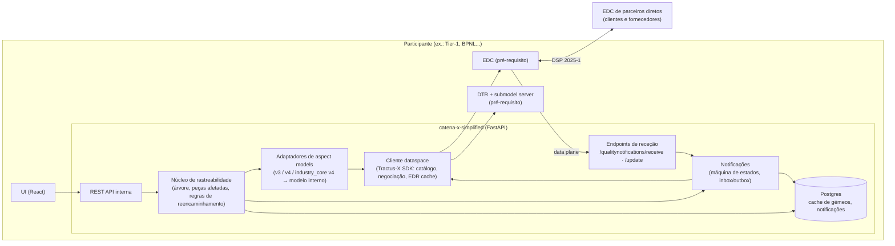
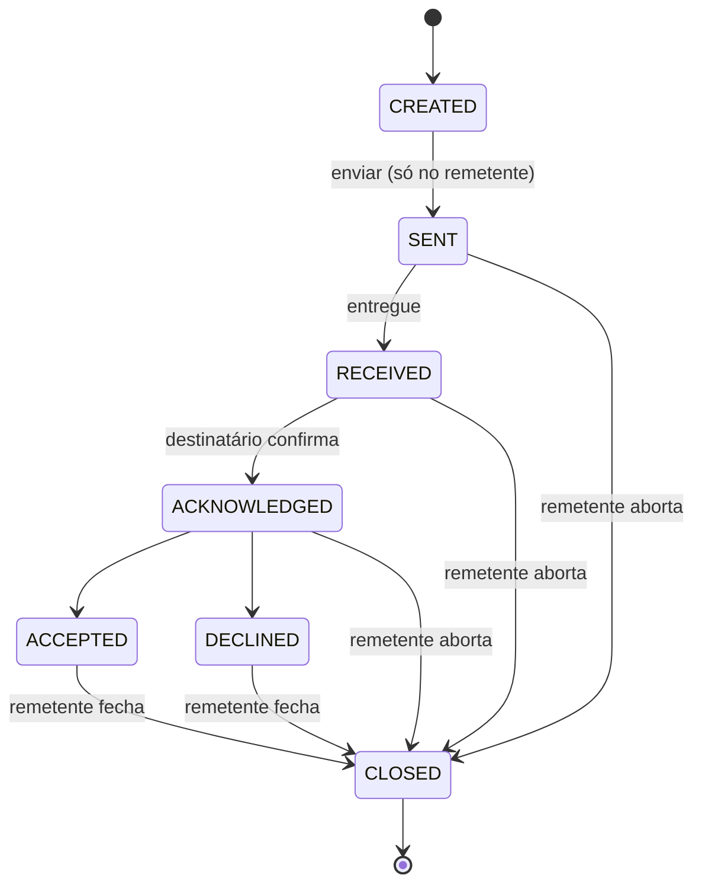
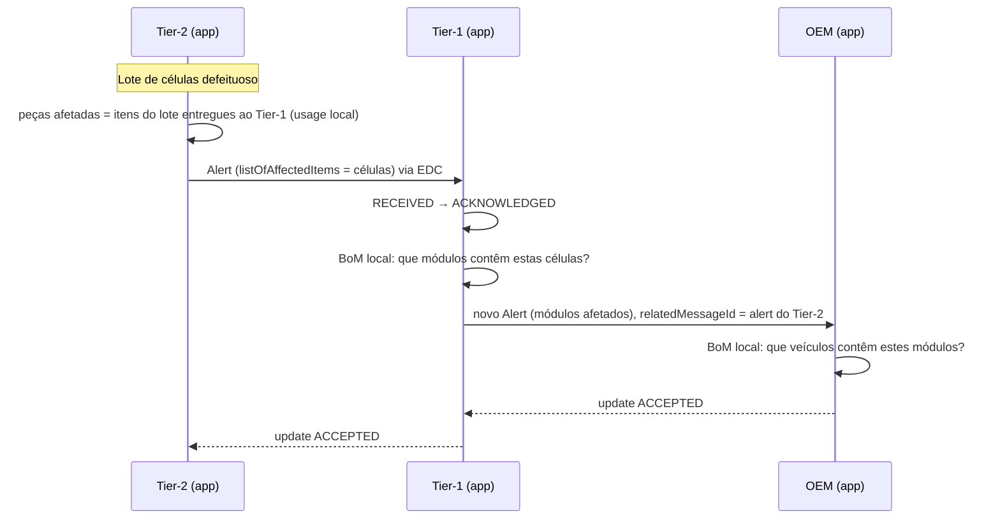

# Arquitetura — catena-x-simplified

> Estado: proposta inicial (v0.1) · Base: **Eclipse Tractus-X 26.03** · KIT: **Traceability KIT 8.0.0**

## 1. Objetivo

Uma aplicação de rastreabilidade **leve e interoperável** para a Catena-X, que cumpre os requisitos
obrigatórios do [Traceability KIT](https://github.com/eclipse-tractusx/eclipse-tractusx.github.io/tree/main/docs-kits/kits/traceability-kit)
sem herdar a complexidade do Trace-X (`eclipse-tractusx/traceability-foss`), que deixou de ser mantido
após a release 25.06.

### 1.1 Âmbito (requisitos funcionais do KIT)

| Requisito do KIT                          | Obrigatório | Nesta app            |
|-------------------------------------------|:-----------:|----------------------|
| Visualizar dados dos Digital Twins        | Sim         | Fase 1               |
| Partilha de dados via conector CX-0018    | Sim         | Fase 1 (pré-requisito) |
| Soberania de dados (access/usage policies)| Sim         | Fase 1               |
| Quality Alerts                            | Sim         | Fase 2               |
| Quality Investigations                    | Sim         | Fase 2               |
| Block Notifications                       | Não         | Fase 4               |

### 1.2 Fora de âmbito

- Instalar ou operar EDC, DTR, submodel server, wallet ou IAM — **são pré-requisitos** (secção 2).
- Publicação dos dados das próprias peças (Industry Core KIT) — assume-se que o participante já publica.
  Existe apenas um script de *seeding* para o ambiente de demonstração.
- Travessia recursiva da cadeia completa (o papel do IRS no Trace-X) — ver secção 5.
- Suporte a conectores/políticas **Jupiter** (DSP 0.8). O suporte Jupiter termina no fim de 2026;
  a app é **Saturn-only** (DSP 2025-1, CX-0152).

## 2. Pré-requisitos (infraestrutura do participante)

A app assume que a empresa já é participante Catena-X e fornece, por configuração:

| Componente                       | Uso pela app                                                          |
|----------------------------------|-----------------------------------------------------------------------|
| Tractus-X EDC (Management API)   | Catálogo, negociação, EDRs; registo dos assets de notificação         |
| EDC data plane (público)         | Receção das notificações enviadas pelos parceiros                     |
| Digital Twin Registry (próprio)  | Leitura dos gémeos das próprias peças                                  |
| Submodel server (próprio)        | Leitura dos aspect models das próprias peças                           |
| Identidade (BPNL, DID, wallet)   | Usada pelo EDC; a app só precisa do BPNL próprio                       |
| Discovery (BPN/EDC discovery)    | Resolver o endpoint DSP de um parceiro a partir do BPNL                |

## 3. Versões-alvo

**Base: release Tractus-X 26.03**, escolhida por ter um ambiente de referência completo e testado
(umbrella chart `26.03.00`, incluindo wallet stub) e por o Traceability KIT 8.0.0 ser declarado
compatível com a 26.03.

| Componente                  | Versão (26.03)        | Notas                                                      |
|-----------------------------|-----------------------|------------------------------------------------------------|
| Tractus-X EDC               | 0.12.0                | DSP 2025-1, políticas Saturn                               |
| Digital Twin Registry       | 0.11.0                | AAS API v3                                                 |
| Identity Hub                | 0.3.2                 | Em dev: `ssi-dim-wallet-stub` do umbrella                  |
| Tractus-X SDK (Python)      | compatível com 0.12   | Abstração de EDC/DTR; ver ADR-02                           |
| Traceability KIT            | 8.0.0                 |                                                            |
| Notification API            | 2.0.0 **e** 1.2.1     | 1.2.1 é obrigatória no KIT; ver secção 6.3                 |
| Umbrella (dev/test)         | 26.03.00              |                                                            |

**Preparação para 26.09** (EDC 0.13.0, DTR 0.13.0, modelos em `io.catenax.industry_core.*`):

- nunca usar endpoints da Management API marcados como *deprecated* (`/v2/edrs`, `v4alpha/*`, …);
- todo o acesso ao EDC/DTR passa pelo SDK, atrás de interfaces próprias;
- URNs de aspect models em configuração, nunca em código de domínio.

## 4. Visão geral

### 4.1 Módulos

| Módulo        | Responsabilidade                                                                         |
|---------------|------------------------------------------------------------------------------------------|
| `dataspace`   | Única porta para EDC/DTR/submodelos. Usa o Tractus-X SDK. Cache de contratos e EDRs.      |
| `aspects`     | Adaptadores por versão de aspect model → modelo interno. Registo de `semanticId`s.        |
| `traceability`| Árvore de um nível, cálculo de peças afetadas, sugestão de destinatários.                 |
| `notifications`| Payloads 1.2.1/2.0.0, máquina de estados, envio/receção, registo dos assets no EDC.     |
| `api`         | API REST para a UI.                                                                      |
| `web`         | UI React.                                                                                |

## 5. Princípios de performance (lições do Trace-X)

O ponto fraco do Trace-X era a dependência do IRS: travessia recursiva da cadeia completa, com
descoberta, negociação EDC e leitura de DTR **em cada salto**, em jobs assíncronos. Nesta app:

1. **Só um nível entre empresas.** Cada participante só conhece (e só precisa de conhecer) os seus
   clientes e fornecedores diretos. A propagação além disso é feita **pelas notificações, salto a
   salto**, como o KIT descreve — cada parceiro decide reencaminhar.
2. **Negociar uma vez, reutilizar muitas.** Contract agreements e EDRs são guardados e reutilizados
   enquanto válidos (por parceiro e por asset), em vez de uma negociação por pedido.
3. **Cache local de gémeos de parceiros**, com sincronização periódica/incremental e refresh a pedido;
   a UI lê sempre da cache.
4. **Consultas locais em SQL.** A árvore própria (BoM/usage de um nível) e o cálculo de peças afetadas
   correm sobre a base de dados local, em milissegundos.
5. **Nada de IRS.** O IRS na 26.09 nem é compatível com políticas Saturn.

## 6. Dados e protocolos

### 6.1 Aspect models — "ler com tolerância, publicar o mais recente"

Muitos parceiros ainda publicam **SerialPart 3.x**, que continua com estado *release* no repositório
oficial de modelos. A app aceita todas as versões em uso e normaliza-as num modelo interno.

| Modelo interno     | Versões aceites (`semanticId`)                                                                 |
|--------------------|-----------------------------------------------------------------------------------------------|
| `Part` (serial)    | `io.catenax.serial_part:3.0.0`, `3.0.1`, `4.0.0`; `io.catenax.industry_core.serial_part:4.0.0` |
| `Part` (batch)     | `io.catenax.batch:3.0.0`, `3.0.1`, `4.0.0`; `io.catenax.industry_core.batch:4.0.0`             |
| `BomRelation`      | `io.catenax.single_level_bom_as_built:3.0.0`, `4.0.0`; `io.catenax.industry_core.single_level_bom_as_built:4.0.0` |
| `UsageRelation`    | `io.catenax.single_level_usage_as_built:3.0.0`, `4.0.0`; `io.catenax.industry_core.single_level_usage_as_built:4.0.0` |

Diferenças principais v3 → v4 (mapeadas nos adaptadores): `catenaXId` → `globalAssetId`,
`catenaXsiteId` → `siteId`, `classificationID` → `classificationId`, `date` → `productionDate`,
quantity 2.0.0 → 3.0.0. A versão concreta é escolhida pelo `semanticId` do submodelo no DTR; nenhum
código fora de `aspects` conhece versões.

Versões invalidadas (SerialPart 1.x/2.x, BoM 1.x/2.x) não são suportadas.

### 6.2 Notificações de qualidade

- **Quality Investigation**: cliente → fornecedor direto (top-down).
- **Quality Alert**: fornecedor → cliente direto (bottom-up).
- Header `io.catenax.shared.message_header` com `context`
  `Traceability-QualityNotification-Investigation:2.0.0` / `…-Alert:2.0.0`.
- Itens afetados referenciados pelo `globalAssetId` (Catena-X ID, `urn:uuid:…`).

Máquina de estados (KIT):

`CLOSED` só pode ser definido pelo iniciador: para fechar normalmente após `ACCEPTED`/`DECLINED`,
ou para abortar uma notificação que deixou de ser relevante.

### 6.3 Versões da Notification API

O KIT 8.0.0 declara a **1.2.1 obrigatória** e a **2.0.0 opcional**. A 2.0.0 é essencialmente um
superconjunto (acrescenta `relatedQualityTaskId`, anexos e `populationFilterList`;
`listOfAffectedItems` deixa de ser obrigatório). Por isso:

- **Receção**: um único parser (superconjunto 2.0.0) aceita ambas as versões; publicamos **dois
  assets por endpoint**, um com `cx-common:version` `1.2.1` e outro com `2.0.0`.
- **Envio**: seguindo o KIT, escolhemos no catálogo do parceiro o asset com a versão compatível mais
  alta (`2.0.0` → `1.2.1`) e serializamos nessa versão. Sem versão compatível, não se negocia.
- `dct:type` dos assets: `ReceiveQualityInvestigationNotification`,
  `UpdateQualityInvestigationNotification`, `ReceiveQualityAlertNotification`,
  `UpdateQualityAlertNotification` (e `…BlockNotification` na fase 4).

### 6.4 Políticas

- Apenas políticas **Saturn** (CX-0152, contexto ODRL `https://w3id.org/dspace/2025/1/odrl-profile.jsonld`).
- Access policy dos assets de notificação restrita por BPNL (parceiros diretos conhecidos).
- Antes de negociar, a app valida as usage policies oferecidas contra regras configuráveis da empresa;
  se nenhuma oferta for conforme, não negocia (requisito do KIT).

## 7. Fluxos principais

### 7.1 Alert propagado salto a salto

Cada salto é uma notificação independente entre parceiros diretos, ligada à anterior por
`relatedMessageId`. Nenhum nó precisa de ver a cadeia completa.

### 7.2 Investigation

Simétrico: o OEM investiga um módulo junto do Tier-1, que identifica as células na sua BoM e abre uma
investigation junto do Tier-2.

## 8. Ambiente de desenvolvimento e testes

- **Unitários**: sem infraestrutura; EDC/DTR simulados atrás das interfaces do módulo `dataspace`.
- **Integração/E2E**: umbrella chart `26.03.00` (Kubernetes local, p.ex. kind/minikube), que já traz
  três participantes com EDC + DTR + submodel server (`tx-data-provider`, `dataconsumerOne`,
  `dataconsumerTwo`) e o wallet stub. Mapeamento para o cenário de demonstração:

| Participante umbrella | Papel no cenário | Aspect models publicados (seeding) |
|-----------------------|------------------|------------------------------------|
| `dataconsumerTwo`     | Tier-2 (células) | **v3** (parceiro "atrasado")       |
| `tx-data-provider`    | Tier-1 (módulos) | v4                                 |
| `dataconsumerOne`     | OEM (veículos)   | v4                                 |

Um nó em v3 garante que o cenário misto é testado desde o início.

## 9. Stack

| Camada     | Escolha                                   |
|------------|-------------------------------------------|
| Backend    | Python 3.12, FastAPI, Tractus-X SDK        |
| Base dados | PostgreSQL 15+                            |
| Frontend   | React + TypeScript                        |
| Deploy     | Imagem de container + Helm chart          |

## 10. Fases

1. **Núcleo** — módulos `dataspace` e `aspects` (v3/v4), leitura do DTR próprio, cache, árvore de um
   nível, API e UI mínima de peças.
2. **Notificações** — assets no EDC, receção/envio 1.2.1 e 2.0.0, máquina de estados, alerts e
   investigations, reencaminhamento assistido.
3. **Demonstração** — seeding dos três participantes no umbrella, cenário E2E automatizado, UI completa.
4. **Extensões** — Block Notifications 2.0.0, qualityTask/ZeroKmFailure, migração para 26.09.

## 11. Decisões (ADR resumidos)

- **ADR-01 — Infraestrutura Catena-X é pré-requisito.** A app não instala EDC/DTR/wallet; consome-os.
- **ADR-02 — Python + Tractus-X SDK.** O SDK oficial cobre catálogo, negociação, EDRs (Jupiter e
  Saturn) e DTR, e acompanha as versões da comunidade; evita reimplementar e manter essa camada.
- **ADR-03 — Base 26.03, preparada para 26.09.** Ambiente de referência completo; migração limitada
  a configuração e ao módulo `dataspace`.
- **ADR-04 — Sem IRS; propagação salto a salto.** Ver secção 5.
- **ADR-05 — Saturn-only.** Jupiter termina no fim de 2026.
- **ADR-06 — Aspect models tolerantes (v3 + v4).** A maioria dos parceiros ainda está em SerialPart 3.
- **ADR-07 — Notification API 1.2.1 + 2.0.0.** 1.2.1 é obrigatória no KIT; 2.0.0 é superconjunto.

## 12. Riscos e questões em aberto

- **Wallet**: as releases Tractus-X não incluem uma identity wallet FOSS completa; em produção depende
  da solução de identidade do participante (fora de âmbito). Em dev usa-se o wallet stub.
- **Parceiros em Jupiter até ao fim de 2026**: não são alcançáveis pela app até migrarem.
- **Versão exata do Tractus-X SDK** compatível com EDC 0.12.0 a confirmar na fase 1.
- **Discovery**: confirmar na fase 1 o mecanismo de descoberta de conectores disponível no umbrella
  26.03 (discovery services vs. descoberta via DID).
